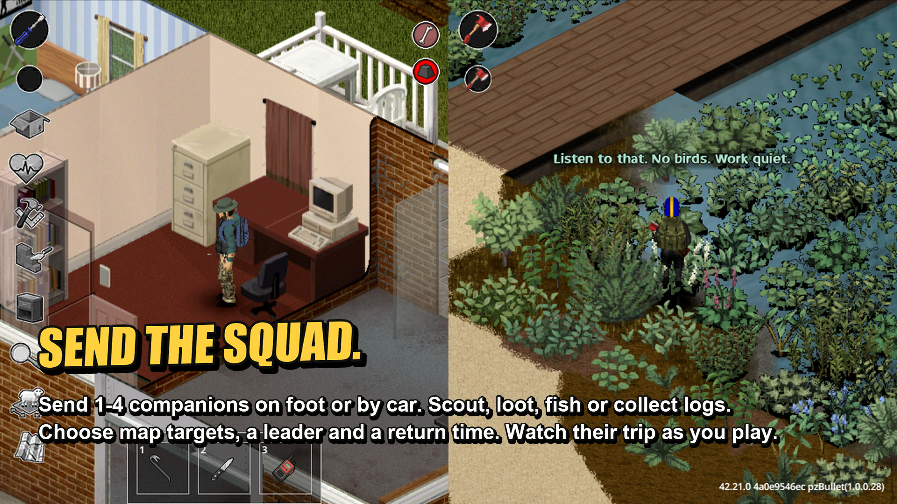
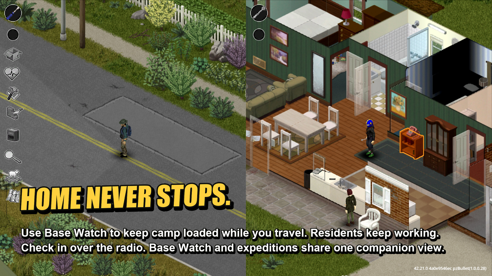
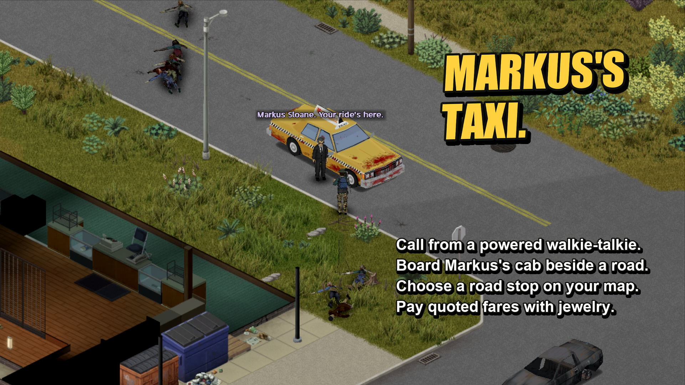
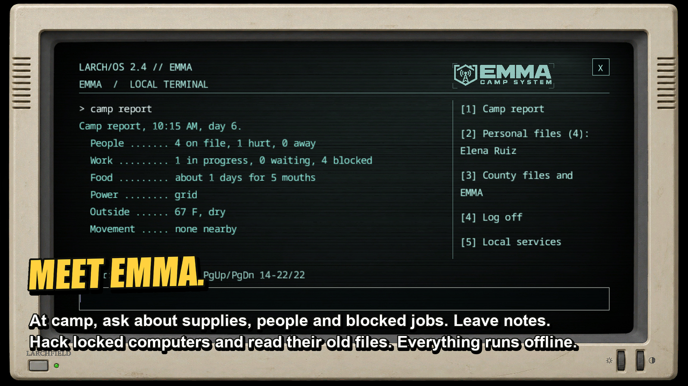

<!-- SPDX-License-Identifier: MIT -->

# Living Fellows

*You won't die... alone.*

**[Read the Field Guide →](https://thorelvin.github.io/living-fellows/)** · [Quick reference](https://thorelvin.github.io/living-fellows/quick-reference.html) · [Steam Workshop](https://steamcommunity.com/sharedfiles/filedetails/?id=3805760339)

  

Companions, working bases and survivor stories for Project Zomboid. Find your people, build a home and send a crew across town while you keep camp going. Your fellows carry real supplies, get hurt and remember what happens.

> **Playing 42.22.2? [Download the standalone Windows release →][standalone]**
>
> Recommended for this game version. Includes its own native bridge; no ZombieBuddy required. [Installation help](INSTALL.md).

## Send a crew. Bring them home.

Send one to four companions to scout, loot, fish or collect wood, on foot or by car. Pick a map target and return time, then watch their trip in a second view while you play. They bring back actual cargo and unload it into camp storage.

## Base Watch and Markus's taxi

<table>
  <tr>
    <td width="50%" valign="top">
      
      
<strong>Home keeps working.</strong> Leave an indoor resident on Base Watch so camp stays loaded while you're away. Others keep sorting, farming, cooking, repairing and guarding. Check in by radio.

    </td>
    <td width="50%" valign="top">
      
      
<strong>Markus is still taking fares.</strong> Call from a powered walkie-talkie, meet his cab beside a road and choose a road destination on your map. Bring jewelry for the fare.

    </td>
  </tr>
</table>

Base Watch, expeditions and Send Home share one companion view. Use one at a time.

**Farmers care for chickens, too.** Put a vanilla animal zone inside camp or
within 30 tiles of its boundary, keeping the whole pen in reach. Add a hutch
and separate feed and water troughs. Mark farming storage for supplies
and food storage for eggs. Farmers feed, water, collect eggs, open the hutch after
dawn and clean it. At night they close the hutch once every known bird is
sheltered; late birds keep the door open. Fertilised eggs stay untouched.
Breeding management and culling remain disabled.

**Cattle share the same care.** Keep the whole vanilla pasture within the same camp work reach,
with separate feed and water troughs and supplies in marked Farming storage.
Farmers use animal feed, hay and cut grass. Cattle pastures can span up to
1,024 tiles. Farmers borrow empty milk containers from Farming storage, milk
lactating cows and deliver to Fresh food, then Regular food when needed.
Calves keep a milk reserve; one daily job can make several delivery trips.

## Meet EMMA

A county assistant is still running on the computers you find. At camp, ask EMMA about supplies, people, jobs and expeditions. She remembers notes and follow-ups: ask about generators, then their fuel. Recover locked machines, read old owners' outbreak files, discover unusual computer personalities and reconnect substations to restore grid power.

**She's more caring, too.** EMMA recognizes grief, distress and self-doubt, remembers the conversation and asks when she's unsure. Her usual jokes pause while she listens. Everything runs offline, with no internet or hosted AI service.

Mount a walkie-talkie on a powered camp computer and assign a **Survivor radio watch**. Follow your operator's search on the animated radio desk and choose whether to invite new contacts to camp.

## People worth knowing

- **Build your crew.** Up to 16 companions with professions, personalities and memories. Some keep private diaries. Fight together, treat wounds or send someone home. Death is permanent.
- **Understand their trust.** Named stages and recent changes show where you stand. Offer food, water or medical help without barter. Helping a real need builds trust.
- **Give them a home.** Assign jobs, grow food, build, maintain vehicles and bury the dead. Blocked work pauses and retries, with an explanation and a manual Retry button.
- **Meet the others.** Households trade, offer work and remember your treatment. Strange Folk bring their own stories and bad habits. Random eligible encounters can begin on day two.

## Get started

**Project Zomboid 42.22.2 · Windows standalone · Single-player.** Multiplayer and additional human split-screen players are not supported.

1. Download the **[standalone Windows ZIP][standalone]** and extract the whole folder.
2. Close Project Zomboid and run **Install.bat** from that folder.
3. Start the game and enable **Living Fellows** in **Mods**. For an existing save, enable it under **More… → Choose Mods** too.

Keep the extracted folder for **Uninstall.bat**. See the [installation guide](INSTALL.md) for updating or another Steam library.

<strong>Using Steam Workshop instead?</strong>

Subscribe to [Living Fellows](https://steamcommunity.com/sharedfiles/filedetails/?id=3805760339) and [ZombieBuddy](https://steamcommunity.com/sharedfiles/filedetails/?id=3619862853) **2.3.3 or newer**. Complete ZombieBuddy's one-time loader setup, then enable both for your save. Standalone is recommended for 42.22.2.

Use one edition at a time. Check the version-specific [Bandits2](docs/compatibility-bandits2.md) and [Project A-Life](docs/compatibility-project-alife.md) compatibility notes before combining NPC mods.

## Your first evening

1. Press **Home** or click the orange **LF** tab. The **First steps** card on Status follows your progress.
2. Right-click a survivor to **Talk**. Get to know them, offer help and ask about joining.
3. Open **Living Fellows** in the ground's right-click menu and choose **Establish camp here…**.
4. Right-click a container → **Living Fellows → Mark storage as…**. Assign jobs at the top of **More → Base**. When marking an area, left-click its opposite corner to finish.

The **[Field Guide](https://thorelvin.github.io/living-fellows/)** walks through orders, camp work, travel, computers and the people you'll meet.

## Need a hand?

Open **More → Support** for a diagnostic report. Include it, your game and mod versions, and a screenshot or relevant logs in a [bug report](https://github.com/thorelvin/living-fellows/issues/new/choose). You can also join us on [Discord](https://discord.gg/vPK7faQVt).

[What's new](CHANGELOG.md) · [Contributing and building](CONTRIBUTING.md) · [Architecture](ARCHITECTURE.md) · [MIT license](LICENSE)

Project Zomboid belongs to The Indie Stone. Living Fellows is an independent mod, not affiliated with or endorsed by them.

[standalone]: https://github.com/thorelvin/living-fellows/releases/latest
