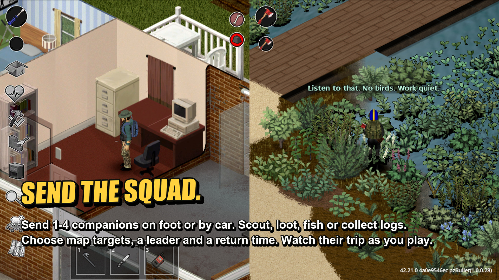
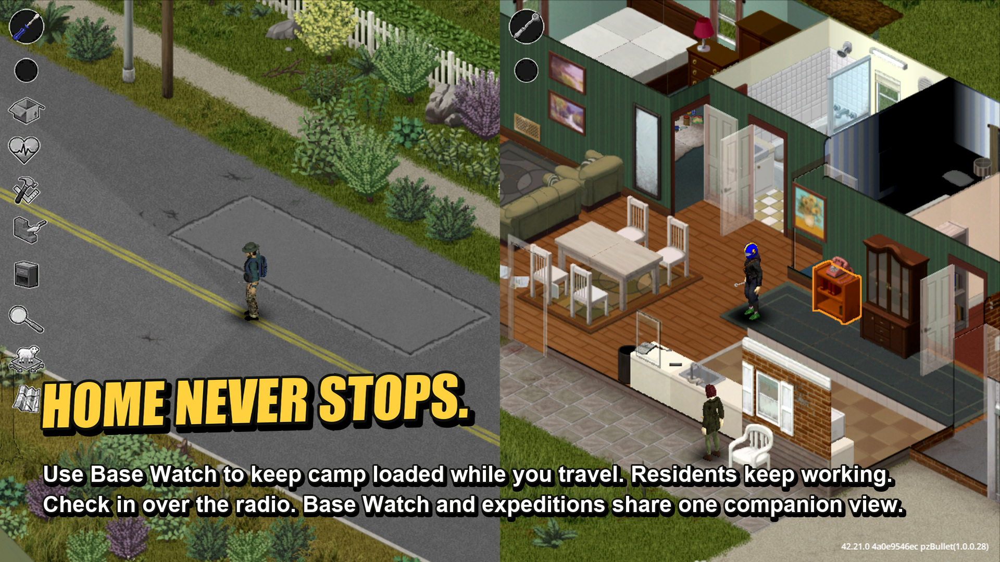
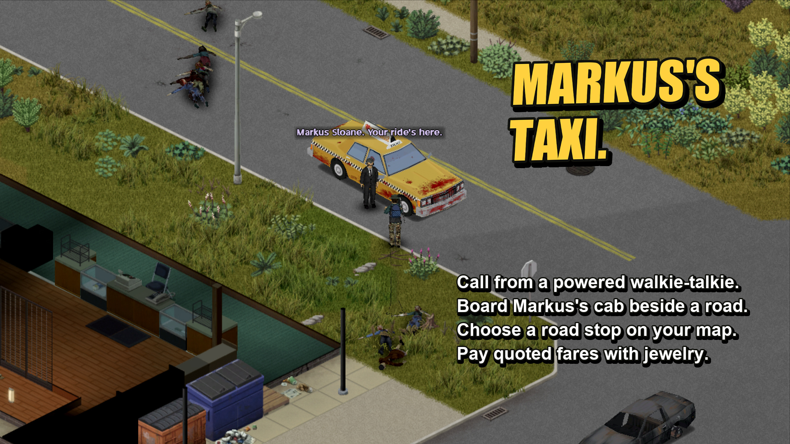
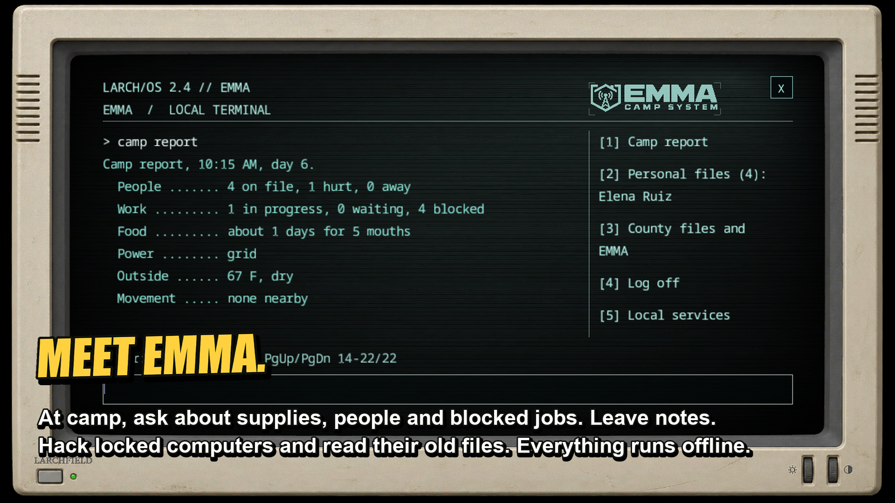

<!-- SPDX-License-Identifier: MIT -->

# Living Fellows

*You won't die... alone.*

**[Read the Field Guide →](https://thorelvin.github.io/living-fellows/)** · [Quick reference](https://thorelvin.github.io/living-fellows/quick-reference.html) · [Steam Workshop](https://steamcommunity.com/sharedfiles/filedetails/?id=3805760339)

  

Companions, working bases and survivor stories for Project Zomboid. Find your people, build a home and send a crew across town while you keep camp going. Your fellows carry real supplies, get hurt and remember what happens.

After your death, **The Handover** lets the camp carry on. Create a fresh survivor
at base or permanently play a living recruit at their current location, keeping
their skills, gear and wounds. Separated followers seek shelter and call for help
when working radios connect them to you. Ordinary respawn remains available.

**Power Night** brings familiar voices back to camp. Access an unlocked EMMA
computer, then open **Local services > Power Night** for the archive channels.
Tune a TV or radio for the nightly 20:00-21:00 slot while the grid is on.
Available companions may join, learn and talk about the programme afterward.
Copy found recordings at EMMA to expand the archive; you keep the originals.

> **Playing 42.22.2? [Download the standalone Windows release →][standalone]**
>
> Recommended for this game version. Includes its own native bridge; no ZombieBuddy required. [Installation help](INSTALL.md).

## Send a crew. Bring them home.

Send one to four companions to scout, loot, fish or collect wood, on foot or by car. Fuel runs top up the car and bring filled gas cans home from a known station. Pick a map target and return time, then watch their trip in a second view while you play. They bring back actual cargo and unload it into camp storage.

## Call a companion for a pickup

Right-click an equipped, powered two-way radio and choose **Camp pickup**, or
open it from EMMA's Radio desk. A single sheet suggests an available camp driver,
a real parked car and a nearby roadside meeting point. You can change the driver
or car before calling. The driver needs the key and enough fuel for the return.

Companions following or regrouping with you within 35 metres come along when
there are enough seats. Get in, then choose **Take us Home** or right-click a
destination on the map. Everyone gets out normally; the driver brings the empty
car back to camp and resumes duty. A held journey has **Retry**. Radio updates
and cancellations apply only after a reply; local instructions need no radio.
Radio-equipped EMMA computers can answer at camp even if the driver has no walkie.

## Base Watch and Markus's taxi

<table>
  <tr>
    <td width="50%" valign="top">
      
      
<strong>Home keeps working.</strong> Leave an indoor resident on Base Watch so camp stays loaded while you're away. Others keep sorting, farming, cooking, repairing and guarding. Check in by radio.

    </td>
    <td width="50%" valign="top">
      
      
<strong>Markus is still taking fares.</strong> Call from a powered walkie-talkie, meet his cab beside a road and choose a road destination on your map. Bring jewelry for the fare.

    </td>
  </tr>
</table>

Base Watch, expeditions, Send Home and pickups share one companion view. Pickup
borrows Base Watch while travelling and restores it when possible. Its reservation
lasts until the car is returned, including the passenger ride in your own view.

**Farmers care for chickens, too.** Put a vanilla animal zone inside camp or
within 30 tiles of its boundary, keeping the whole pen in reach. Add a hutch
and separate feed and water troughs. Mark farming storage for supplies
and food storage for eggs. Farmers feed, water, collect eggs, open the hutch after
dawn and clean it. At night they close the hutch once every known bird is
sheltered; late birds keep the door open. Fertilised eggs stay untouched.
Breeding management and culling remain disabled.

**Cattle share the same care.** Keep the whole vanilla pasture within the same camp work reach,
with separate feed and water troughs and supplies in marked Farming storage.
Farmers use animal feed, hay and cut grass. Cattle pastures can span up to
1,024 tiles. Farmers borrow empty milk containers from Farming storage, milk
lactating cows and pour into marked Milk barrels, with food storage as a fallback.
Calves keep a milk reserve; one daily job can make several delivery trips.

**Sheep join the farm.** Farmers care for all vanilla breeds, milk ewes while
leaving nursing lambs a reserve, and shear mature sheep with real tools.
They gather the wool and deliver it to Crafting, then General storage.

Farmers soothe stressed animals and gather manure for marked composters or
Manure storage. Medics pack and use a stocked first aid kit, keeping dressings
and a splint ready for real injuries.

## Meet EMMA

A county assistant is still running on the computers you find. At camp, ask EMMA about supplies, people, jobs and expeditions. She remembers notes and follow-ups: ask about generators, then their fuel. Recover locked machines, read old owners' outbreak files, discover unusual computer personalities and reconnect substations to restore grid power.

**She's more caring, too.** EMMA recognizes grief, distress and self-doubt, remembers the conversation and asks when she's unsure. Her usual jokes pause while she listens. Everything runs offline, with no internet or hosted AI service.

Mount a walkie-talkie on a powered camp computer and assign a **Survivor radio watch**. Follow your operator's search on the animated radio desk and choose whether to invite new contacts to camp.

## People worth knowing

- **Build your crew.** Up to 16 companions with professions, personalities and memories. Some keep private diaries. Fight together, treat wounds or send someone home. Death is permanent.
- **Understand their trust.** Named stages and recent changes show where you stand. Offer food, water or medical help without barter. Helping a real need builds trust.
- **Give them a home.** Assign jobs, grow food, build, maintain vehicles and bury the dead. Blocked work pauses and retries, with an explanation and a manual Retry button.
- **Fight as one squad.** Fellows share out the zombies that can reach them, protect you first and count only free fighters as backup. A fit fellow holds two zombies at once; past that the group gives ground together, into a doorway or onto a stair top within a few metres of you when there is one. When they pull out, the fittest fighter covers the others and leaves last. They fight from the landing or the foot of the stairs, never on the steps, and call out when the fight turns.
- **Hold an entrance.** Aim "Guard here" at a doorway or stair landing. Guards face the approach, ready their weapons for climbers on any column of a wide staircase and leave room for the next defender. At a door the front guard stays in line with the opening and fights the zombie coming through while the rest wait their turn outside. Repeated shoves can draw one attacker onto level ground; the group falls back to you when it cannot hold. Ordinary guard posts still patrol.
- **Make a looting stop count.** Fellows check freezers and bags, take useful supplies in batches and bring extras home. They keep their own rations and tools; full storage leaves delivery pending for retry.
- **Meet the others.** Households trade, offer work and remember your treatment. Strange Folk bring their own stories and bad habits. Random eligible encounters can begin on day two.

## Get started

**Project Zomboid 42.22.2 · Windows standalone · Single-player.** Multiplayer and additional human split-screen players are not supported.

With **PZO (prop11)**, the installer keeps PZO's launcher and uses its Java mod
loader to start Living Fellows. Allow the Living Fellows bridge if PZO asks.
An updated bridge needs approval again; keep third-party Java mods enabled in
**F10 → JAVA**, then fully restart the game after changing that setting.
Re-run `Install.bat` from the current download to repair the older LF Java-agent
startup option, which can prevent the Windows game executable from starting.

1. Download the **[standalone Windows ZIP][standalone]** and extract the whole folder.
2. Close Project Zomboid and run **Install.bat** from that folder.
3. Start the game and enable **Living Fellows** in **Mods**. For an existing save, enable it under **More… → Choose Mods** too.

Keep the extracted folder for **Uninstall.bat**. See the [installation guide](INSTALL.md) for updating or another Steam library.

<strong>Using Steam Workshop instead?</strong>

Subscribe to [Living Fellows](https://steamcommunity.com/sharedfiles/filedetails/?id=3805760339) and [ZombieBuddy](https://steamcommunity.com/sharedfiles/filedetails/?id=3619862853) **2.3.3 or newer**. Complete ZombieBuddy's one-time loader setup, then enable both for your save. Standalone is recommended for 42.22.2.

Use one edition at a time. Check the version-specific [Bandits2](docs/compatibility-bandits2.md), [Project A-Life](docs/compatibility-project-alife.md) and [Stay With Me](docs/compatibility-stay-with-me.md) compatibility notes before combining NPC mods.

## Your first evening

1. Press **Home** or click the orange **LF** tab. The **First steps** card on Status follows your progress.
2. Right-click a survivor to **Talk**. Get to know them, offer help and ask about joining.
3. Open **Living Fellows** in the ground's right-click menu and choose **Establish camp here…**.
4. Right-click a container → **Living Fellows → Mark storage as…**. Assign jobs at the top of **More → Base**. When marking an area, left-click its opposite corner to finish.

The **[Field Guide](https://thorelvin.github.io/living-fellows/)** walks through orders, camp work, travel, computers and the people you'll meet.

## Need a hand?

Pause the game and choose **Report a Living Fellows bug**. Describe what happened and how to reproduce it, then review the draft. It includes the game and mod versions, bridge protocol and recent diagnostic summaries. Choose **Open GitHub draft** to finish and submit it in your browser. You can also use the [bug report form](https://github.com/thorelvin/living-fellows/issues/new/choose) directly.

Open **More → Support** for additional diagnostics, or join us on [Discord](https://discord.gg/vPK7faQVt).

[What's new](CHANGELOG.md) · [Contributing and building](CONTRIBUTING.md) · [Architecture](ARCHITECTURE.md) · [MIT license](LICENSE)

Project Zomboid belongs to The Indie Stone. Living Fellows is an independent mod, not affiliated with or endorsed by them.

[standalone]: https://github.com/thorelvin/living-fellows/releases/latest
