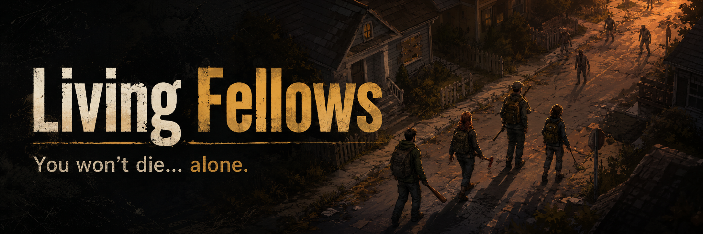

<!-- SPDX-License-Identifier: MIT -->

# Living Fellows

*You won't die... alone.*

**[Read the Field Guide →](https://thorelvin.github.io/living-fellows/)** · [Quick reference](https://thorelvin.github.io/living-fellows/quick-reference.html) · [Steam Workshop](https://steamcommunity.com/sharedfiles/filedetails/?id=3805760339)

  

Find your people. Give them a place to live. Try to bring everyone home.

Living Fellows adds companions, survivor households and working bases to Project Zomboid. Your fellows carry real supplies, get hurt, remember what happens to them and make their own decisions when things go wrong.

## More than someone following you

- **Send a squad on an expedition.** Scout a building, search for supplies, fish or collect wood while you get on with your own plans. Send one to four companions on foot or by car, choose a leader and return time, and watch their trip in a second view. They bring back what they actually find and carry it into camp storage.
- **Keep the camp working with Base Watch.** Leave an indoor resident on watch and the camp stays loaded while you travel. The others keep sorting, farming, cooking, repairing and guarding. Check in by radio while you're away. Base Watch and expeditions share one companion view, so run one at a time.
- **Call Markus's taxi.** Stranded on the road? Call for pickup from a working walkie-talkie, climb into Markus Sloane's cab and choose a road destination on the map. Bring jewelry for the fare.
- **Build a crew worth knowing.** Up to 16 companions with professions, personalities, relationships and memories. They fight in formation, look after their needs, treat wounds and retreat when they're outmatched. Some keep private diaries. Death is permanent, and the book stays behind.
- **Make a home that works.** Mark storage and work areas, assign jobs, grow food, build, fell trees, saw planks and bury the dead. Wood goes into neat four-log stacks. Blocked jobs pause and retry automatically; manual Retry stays available.
- **Meet the people still out there.** Households trade, offer work and remember how you treat them. Sixty-five Strange Folk bring their own stories, requests and bad habits. Encounters can begin on the second day, with a random eligible character each time.

The [Field Guide](https://thorelvin.github.io/living-fellows/) covers orders, camp jobs, equipment, travel and the people you'll meet.

## Requirements

**Project Zomboid Build 42.21.0 · Single-player.** Multiplayer and additional human split-screen players are not supported.

Choose one installation method. Workshop and standalone copies share the same mod ID and should not be enabled together.

Using Bandits2 too? See the [optional adapter's scope and test results](docs/compatibility-bandits2.md).

### Steam Workshop

1. Subscribe to [ZombieBuddy](https://steamcommunity.com/sharedfiles/filedetails/?id=3619862853) **2.3.3 or newer** and complete its one-time loader setup. Subscribing alone is not enough.
2. Subscribe to [Living Fellows](https://steamcommunity.com/sharedfiles/filedetails/?id=3805760339).
3. Start the game and enable both in **Mods**. For an existing save, enable both under **More… → Choose Mods** too.

### Standalone for Windows

1. Download the complete repository with **Code → Download ZIP**, or get the standalone Windows package from [Releases](https://github.com/thorelvin/living-fellows/releases).
2. Extract the whole folder, close Project Zomboid and run **Install.bat**.
3. Start the game and enable **Living Fellows** in **Mods** and in the save's **More… → Choose Mods** menu.

This edition includes its own bridge and does not need ZombieBuddy. Keep the extracted folder: **Uninstall.bat** removes the installation. See [INSTALL.md](INSTALL.md) for another Steam library, updating or troubleshooting.

## Your first few minutes

1. Press **Home** to open the companion panel, or click the small **LF** launcher.
2. Meet a survivor, select them and choose **Recruit** when offered. Use **Talk** to get to know them.
3. Set orders and combat style in **Orders**; put companions into groups in **Squad**.
4. Right-click the ground and choose **Living Fellows → Base life → Set camp core here**. Mark storage, then assign jobs at the top of **More → Base**. To remove a storage marking, right-click its container and choose **Base life → Unmark storage**.

Hold **keypad 1** to Peek, press **keypad 2** to toggle Watch, or hold **keypad 3** to steer the selected companion toward the cursor. All three keys can be rebound. Companions, households and camp work are saved with the world, even if your character dies.

## Need a hand?

Open **More → Support** for a diagnostic report. If the panel is missing, check that the mod is enabled for the save; Workshop users should also check ZombieBuddy's loader setup. A stuck companion may recover with **Regroup**.

For a [bug report](https://github.com/thorelvin/living-fellows/issues/new/choose), include the Support report, game and mod versions, what happened and a screenshot or relevant logs. Remove private information before posting.

[What's new](CHANGELOG.md) · [Contributing and building](CONTRIBUTING.md) · [Architecture](ARCHITECTURE.md)

Original mod, [MIT licensed](LICENSE). Project Zomboid belongs to The Indie Stone; Living Fellows is not affiliated with or endorsed by them.
